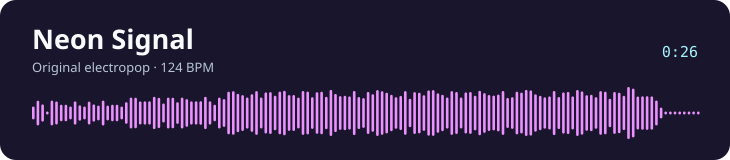

# score-engine

**Write a score in plain text. Render it to audio from the command line.**

score-engine is a C++20 audio renderer with a small language for instruments, notes, and reusable patterns. It mixes samples and synthesized voices into a 44.1 kHz, 16-bit mono WAV.

[Listen](#listen) · [Build and render](#build-and-render) · [Score format](#score-format)

## Listen

[](https://raw.githubusercontent.com/artembatalov/score-engine/main/docs/audio/neon-signal.mp3)

**[Play Neon Signal](https://raw.githubusercontent.com/artembatalov/score-engine/main/docs/audio/neon-signal.mp3)** · [View the score](examples/neon-signal.txt)

An original 26-second electropop demo at 124 BPM. Offbeat bass and pulsing chords build into a layered synth hook. The score uses only built-in oscillators and effects.

### Audio gallery

| Track | Time | Listen | Score | WAV render |
| :--- | ---: | :--- | :--- | :--- |
| **Neon Signal** · original electropop | 0:26 | [MP3](https://raw.githubusercontent.com/artembatalov/score-engine/main/docs/audio/neon-signal.mp3) | [TXT](examples/neon-signal.txt) | [Render locally](#build-and-render) |
| Sweden · C418 | 3:33 | [MP3](https://raw.githubusercontent.com/artembatalov/score-engine/main/docs/audio/sweden.mp3) | [TXT](examples/sweden.txt) | [WAV](https://raw.githubusercontent.com/artembatalov/score-engine/main/compositions/sweden.wav) |
| Bad Apple!! · ZUN | 3:35 | [MP3](https://raw.githubusercontent.com/artembatalov/score-engine/main/docs/audio/badapple.mp3) | [TXT](examples/badapple.txt) | [WAV](https://raw.githubusercontent.com/artembatalov/score-engine/main/compositions/badapple.wav) |
| Bad Hand · Thelonious Dogg | 0:25 | [MP3](https://raw.githubusercontent.com/artembatalov/score-engine/main/docs/audio/badhand.mp3) | [TXT](examples/badhand.txt) | [WAV](https://raw.githubusercontent.com/artembatalov/score-engine/main/compositions/badhand.wav) |
| Tokyo Ghoul opening | 3:49 | [MP3](https://raw.githubusercontent.com/artembatalov/score-engine/main/docs/audio/ghoul.mp3) | [TXT](examples/ghoul.txt) | [WAV](https://raw.githubusercontent.com/artembatalov/score-engine/main/compositions/ghoul.wav) |
| The Lick | 0:02 | [MP3](https://raw.githubusercontent.com/artembatalov/score-engine/main/docs/audio/lick.mp3) | [TXT](examples/lick.txt) | [WAV](https://raw.githubusercontent.com/artembatalov/score-engine/main/compositions/lick.wav) |
| Memory · Toby Fox | 0:31 | [MP3](https://raw.githubusercontent.com/artembatalov/score-engine/main/docs/audio/memory.mp3) | [TXT](examples/memory.txt) | [WAV](https://raw.githubusercontent.com/artembatalov/score-engine/main/compositions/memory.wav) |
| Once Upon a Time · Toby Fox | 1:13 | [MP3](https://raw.githubusercontent.com/artembatalov/score-engine/main/docs/audio/once.mp3) | [TXT](examples/once.txt) | [WAV](https://raw.githubusercontent.com/artembatalov/score-engine/main/compositions/once.wav) |
| Virtual Insanity · Jamiroquai | 4:00 | [MP3](https://raw.githubusercontent.com/artembatalov/score-engine/main/docs/audio/virtual.mp3) | [TXT](examples/virtual.txt) | [WAV](https://raw.githubusercontent.com/artembatalov/score-engine/main/compositions/virtual.wav) |
| Blue Hour · synth demo | 0:19 | [MP3](https://raw.githubusercontent.com/artembatalov/score-engine/main/examples/blue-hour.mp3) | [TXT](examples/blue-hour.txt) | [Render locally](#build-and-render) |

The MP3s for the sample-based arrangements were encoded from the WAV renders in `compositions/`. To render those scores again, place their referenced WAV samples under `samples/` at the repository root.

## Build and render

Requires CMake 3.24+ and a C++20 compiler. CMake downloads GoogleTest during configuration if it cannot find a local installation.

```sh
cmake -S . -B build
cmake --build build --target score-engine
./build/bin/score-engine examples/neon-signal.txt neon-signal.wav
```

Neon Signal and Blue Hour both run without external samples.

## Score format

```text
bpm 112

instrument lead triangle
  attack=360 release=1900
  effect echo delay=0.402 decay=0.26
end

pattern motif resolution 4
  0 lead E5 3 29
  4 lead A5 2 21
  7 lead C6 3 26
end

pattern main resolution 4
  0 @motif
  16 @motif
end
```

- **Instruments** can play WAV samples or synthesize sine, square, and triangle waves. Attack and release are measured in samples. Effects include gain, echo, and tremolo.
- **Notes** list the start tick, instrument, pitch, duration in ticks, and velocity as a percentage. With `resolution 4`, one beat contains four ticks.
- **Patterns** group notes and can be called with `@name`. Rendering starts from the `main` pattern.

## License

Engine source code is available under the [MIT License](LICENSE).
